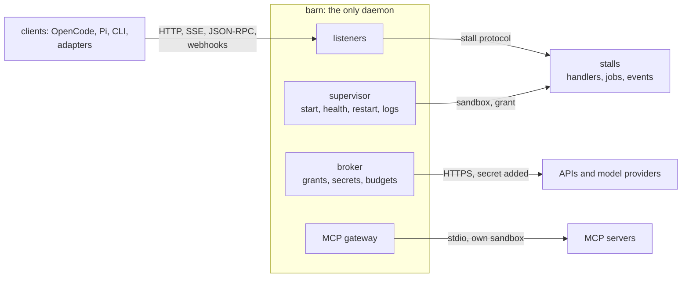

# barn

barn is the only daemon on a wrkhse machine. Each project ships a **stall**
holding only its own logic: its request handlers, its background jobs and the
events it emits.

barn starts each stall in its own sandboxed child process, holds every
listener, and brokers the network, secrets, webhooks, MCP and upgrades.

## Design

Every listener, socket and secret on a wrkhse machine lives in barn. A project
ships a **stall**, not a daemon: an adapter holding only its request
handlers, background jobs and events. Built on barn's stall SDK, a stall speaks
the [stall protocol](docs/stall-protocol.md) over a socket it inherits from
barn, so it can be written in any language. The SDK comes as a Rust crate and a
TypeScript package.

A stall runs in its own sandboxed child process under only what its grant
allows: a sandbox profile, no direct network and no secrets in its environment.
barn starts, restarts and upgrades stalls, holds their listeners and sockets,
runs the launchd or systemd service, keeps logs and health, and brokers secrets,
webhooks and MCP.



| Part                                                                                                                                                                                                                           | What it does                                                                                                                                                                   |
| ------------------------------------------------------------------------------------------------------------------------------------------------------------------------------------------------------------------------------ | ------------------------------------------------------------------------------------------------------------------------------------------------------------------------------ |
| [Supervisor](https://github.com/wrkhse/barn/issues/1)                                                                                                                                                                          | Starts, health-checks, restarts with backoff and upgrades stalls; through a restart it holds the sockets and queues requests until the new stall is ready.                     |
| [Sandbox](https://github.com/wrkhse/barn/issues/11)                                                                                                                                                                            | Turns a grant into an OS policy, nono on macOS and bubblewrap on Linux, allowing only the broker as a network destination and stopping the whole process tree.                 |
| [Broker](https://github.com/wrkhse/barn/issues/9)                                                                                                                                                                              | The only network exit: checks each request against the grant, adds the named secret, never follows a redirect, logs every request and shares per-secret budgets across stalls. |
| [Gateway](https://github.com/wrkhse/barn/issues/10)                                                                                                                                                                            | The one door to MCP servers: shows a stall only its granted tools, runs each local server in its own sandbox and sends its traffic through the broker.                         |
| [Conformance](https://github.com/wrkhse/barn/issues/12)                                                                                                                                                                        | One suite per protocol that an implementation in any language passes to implement it, each with a deliberate break that must fail the suite.                                   |
| [Workhorse stall](https://github.com/wrkhse/barn/issues/13)                                                                                                                                                                    | Holds sessions, steering, the approvals queue and `control`, starts on demand and asks barn to launch each agent under its session's grant with `proc.spawn`.                  |
| Contracts: [grant](https://github.com/wrkhse/barn/issues/14), [steering](https://github.com/wrkhse/barn/issues/15), [approvals](https://github.com/wrkhse/barn/issues/16), [control](https://github.com/wrkhse/barn/issues/17) | Decide what a session may touch, let rules block, rewrite or ask within that ceiling, queue human decisions and carry them as JSON-RPC.                                        |

## Install

With Rust 1.100.0 installed, install the CLI from the pinned source revision:

```sh
cargo install --git https://github.com/wrkhse/barn \
  --rev 521d5f88e565244e72cb2071815579afbb23a038 --locked barn
```

## Check the version

```text
$ barn --version
barn 0.1.0
```

## Write a stall in Rust

```toml
[dependencies]
barn-stall = { git = "https://github.com/wrkhse/barn", rev = "521d5f88e565244e72cb2071815579afbb23a038" }
```

The crate holds the [stall protocol](docs/stall-protocol.md)'s version, limits,
method names and message types.

## Roadmap

- [ ] The supervisor: start, restart and upgrade stalls and hold their listeners
      ([barn#1](https://github.com/wrkhse/barn/issues/1))
- [ ] [Broker](https://github.com/wrkhse/barn/issues/9),
      [gateway](https://github.com/wrkhse/barn/issues/10),
      [sandbox](https://github.com/wrkhse/barn/issues/11) and
      [conformance](https://github.com/wrkhse/barn/issues/12)
- [ ] [The workhorse stall and CLI](https://github.com/wrkhse/barn/issues/13)
- [ ] Contracts: [grant](https://github.com/wrkhse/barn/issues/14),
      [steering](https://github.com/wrkhse/barn/issues/15),
      [approvals](https://github.com/wrkhse/barn/issues/16),
      [control](https://github.com/wrkhse/barn/issues/17)

## More

- [The plan](https://github.com/wrkhse/barn/issues/1)
- [Stall protocol](docs/stall-protocol.md)
- [Broker](https://github.com/wrkhse/barn/issues/9),
  [gateway](https://github.com/wrkhse/barn/issues/10),
  [sandbox](https://github.com/wrkhse/barn/issues/11),
  [conformance](https://github.com/wrkhse/barn/issues/12),
  [workhorse stall](https://github.com/wrkhse/barn/issues/13)
- Contracts: [grant](https://github.com/wrkhse/barn/issues/14),
  [steering](https://github.com/wrkhse/barn/issues/15),
  [approvals](https://github.com/wrkhse/barn/issues/16),
  [control](https://github.com/wrkhse/barn/issues/17)
- [Contributor and agent guidance](AGENTS.md)
