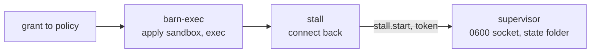

# Slice 1: barn stall sandbox

**Status: Implemented (release candidate and recording come with barn's first
release).**

A stall author can hand barn a grant and a stall program: barn runs it under
the sandbox, it connects back on a private socket, and a crash restarts it.

<!-- prettier-ignore -->
```json
{"jsonrpc":"2.0","id":1,"method":"stall.start","params":{"protocol":1,"token":"…","jobs":{"poll":{"every":"15s"}}}}
{"jsonrpc":"2.0","id":1,"protocol":1,"result":{"state":"/var/lib/barn/sourcefed","jobs":{"poll":{"every":"15s"}}}}
```



## Grant to policy

A grant names the roots, files and executable a stall may use; barn resolves
each path into a nono capability set that blocks network and DNS.

`crates/barn/src/policy.rs` and `crates/barn/tests/policy.rs`: unit and
integration tests, the subpath boundary and PR mutation of changed lines.

## Supervision and transport

barn spawns the stall through barn-exec, checks the peer's PID and UID, spends
the token and returns its state folder; three missed health checks restart it.

`crates/barn/src/supervisor.rs`, `crates/barn-exec/src/main.rs`,
`crates/barn-stall/src/protocol.rs` and `docs/stall-protocol.md` carry unit,
integration, real sandbox process and `include_str!` protocol tests.

## CLI and end-to-end fixture

The command line fixes `status`, `stalls`, `run` and `logs`; a binary fixture
checks exit status and stderr so a script cannot read a stub as a success.

`crates/barn/src/cli.rs`, `crates/barn/tests/cli.rs` and
`crates/barn/tests/exit.rs`: parser tests and a binary test that runs in CI.
The binary test returns at once outside CI.

## End to end

CI runs the full nextest suite and the doc tests on `ubuntu-latest` and
`macos-15`, repeating the restart test thirty times under Seatbelt.

## Decided

| Decision                    | What it fixes                                      |
| --------------------------- | -------------------------------------------------- |
| Draft protocol v1           | Version 1 may change in place until first release. |
| Tack owns daemon auto-start | barn is tack's daemon module; tack starts it.      |
| barn owns grant enforcement | Stalls ship logic only; barn enforces the grant.   |
| Owner-only control socket   | Listens for the owner only; ships in the next PR.  |
