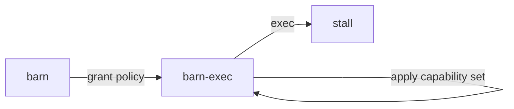

# Sandbox

barn starts every stall under `barn-exec`, a small helper that sandboxes itself
and then replaces itself with the stall binary. The stall never runs outside
its sandbox, and the sandbox cannot be lifted once it is applied.

## The exec grant

`barn-exec` reads the grant's policy and applies it as a nono capability set
before it execs the stall binary. After the apply, the stall can reach only
what the set names.

nono 0.82 maps `AccessMode::Read` to `ReadFile`, `ReadDir` and `Execute`.
Granting the stall executable read access therefore also lets it execute.

## Linux

A statically linked stall needs nothing beyond its own executable. A
dynamically linked stall also needs the ELF loader named in its `PT_INTERP`
header and the libraries that loader maps in.

barn reads the `PT_INTERP` path from the binary's own ELF header. It never
runs `ldd` or any other process to find it. The grant then holds:

- the stall executable: read, execute
- the exact `PT_INTERP` loader file: read, execute
- the library directories for the host's layout, read, execute, each only when
  it exists

On a Debian-style multiarch layout the library directories are the multiarch
directories for the ELF machine type (x86-64 or aarch64),
`/lib/<arch>-linux-gnu` and `/usr/lib/<arch>-linux-gnu`, such as
`/lib/x86_64-linux-gnu`. They are named from the ELF machine type, not from
where the loader lives. On a merged-/usr system, where `/lib` canonicalizes to
`/usr/lib`, the grant stays these directories and never widens to `/usr/lib`.

On any other layout barn grants both roots of the loader's family that exist:
`/lib` and `/usr/lib`, or `/lib64` and `/usr/lib64`. The grant is those roots
plus the exact loader file. When `/usr` is merged and two roots resolve to the
same directory, the grant holds it once. barn grants neither `/` nor a home
folder.

nono's `AccessMode::Read` includes Execute (see above), so the granted
directories are readable and executable but not writable. The stall can execute
any ELF it can read in them. nono 0.82 cannot grant read without execute, so
the grant cannot be narrowed.

barn grants no blanket read of `/`. A stall cannot read a library or file
outside the paths above.

## macOS

barn grants no extra paths. nono's Seatbelt profile already allows
`file-read` on `/` itself, so dyld loads the stall and its libraries without
a grant for them.
