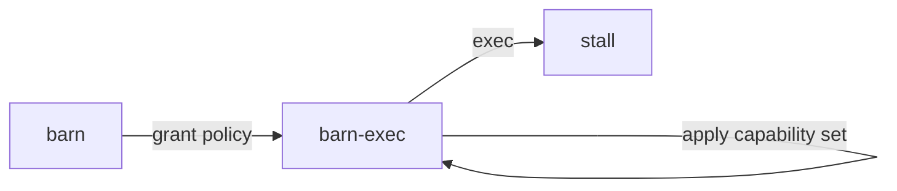

# Sandbox

barn starts every stall under `barn-exec`, a small helper that sandboxes itself
and then replaces itself with the stall binary. The stall never runs outside
its sandbox, and the sandbox cannot be lifted once it is applied.



## The exec grant

`barn-exec` reads the grant's policy and applies it as a nono capability set
before it execs the stall binary. After the apply, the stall can reach only
what the set names.

nono 0.82 maps `AccessMode::Read` to `ReadFile`, `ReadDir` and `Execute`.
Granting the stall executable read access therefore also lets it execute.

## Linux

A statically linked stall needs nothing beyond its own executable. A
dynamically linked stall also needs the ELF loader named in its `PT_INTERP`
header and the libraries that loader maps in.

barn reads the `PT_INTERP` path from the binary's own ELF header. It never
runs `ldd` or any other process to find it. The grant then holds:

- the stall executable: read, execute
- the exact `PT_INTERP` loader file: read, execute
- the Debian-style multiarch directories for the ELF machine type (x86-64 or
  aarch64), `/lib/<arch>-linux-gnu` and `/usr/lib/<arch>-linux-gnu`, such as
  `/lib/x86_64-linux-gnu`: read, execute, each only when it exists

The multiarch directories are granted for reading so the loader can map
libraries. They are named from the ELF machine type, not from where the loader
lives, so they are granted for any loader that passes the check below. The
loader's own parent directory is not granted separately: it is readable only
when it is one of these directories. nono's `AccessMode::Read` includes Execute
(see above), so the stall can also execute any ELF it can read in those
directories. nono 0.82 cannot grant read without execute, so the grant cannot
be narrowed.

A broad library root is never granted: not `/lib` or `/usr/lib` itself. On a
merged-/usr system, where `/lib` canonicalizes to `/usr/lib`, the grant stays
the multiarch directories and never widens to `/usr/lib`.

A loader in a non-multiarch layout (`/lib64`, `/usr/lib64` or Alpine's `/lib`)
is refused at policy time, and the stall does not start. The error is:

```text
unsupported library layout <dir>: barn-luau-stall must be statically linked on this host
```

Portable Linux support needs a static musl build of the stall.

barn grants no blanket read of `/`. A stall cannot read a library or file
outside the paths above.

## macOS

barn grants no extra paths. nono's Seatbelt profile already allows
`file-read` on `/` itself, so dyld loads the stall and its libraries without
a grant for them.
